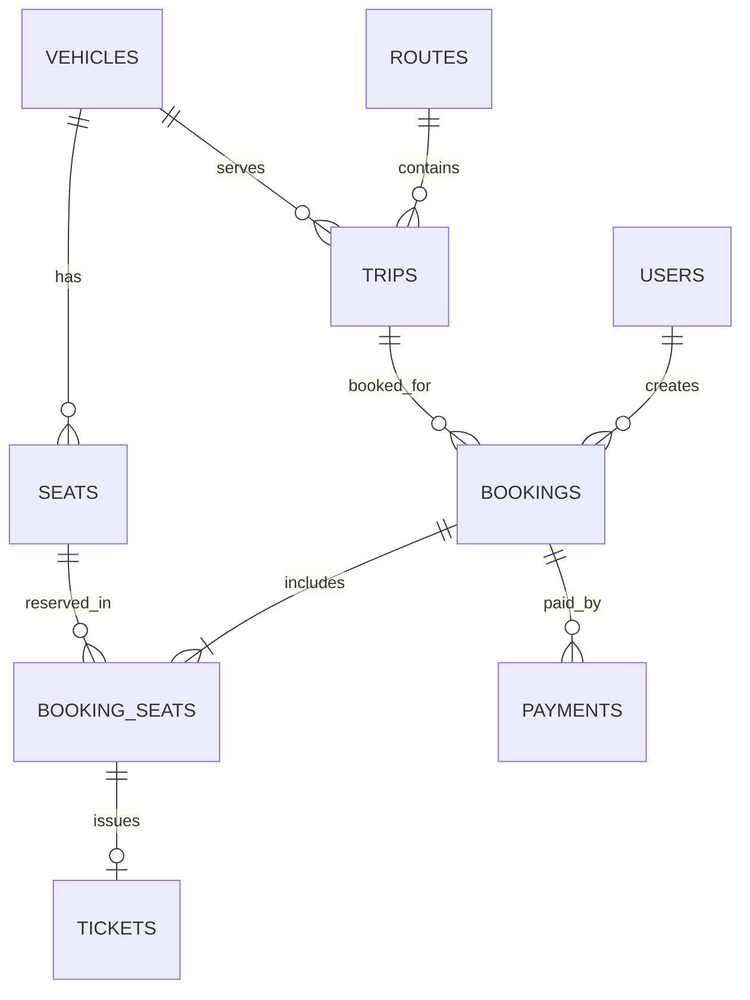

# ERD PostgreSQL

Booking có ít nhất một ghế là invariant nghiệp vụ, chưa được SQL tự bảo đảm.

Khóa ngoại kép:

- `bookings(trip_id,vehicle_id)` → `trips(id,vehicle_id)`.
- `booking_seats(booking_id,trip_id,vehicle_id)` → `bookings(id,trip_id,vehicle_id)`.
- `booking_seats(seat_id,vehicle_id)` → `seats(id,vehicle_id)`.

Chống chiếm trùng: unique `(trip_id,seat_id)` chỉ với `is_active IS TRUE`.

`payments.txn_ref`, `payments.provider_transaction_id`, `tickets.ticket_code`, `tickets.booking_seat_id` có uniqueness theo SQL. Vé chỉ được phát hành từ booking PAID ở service P6.
