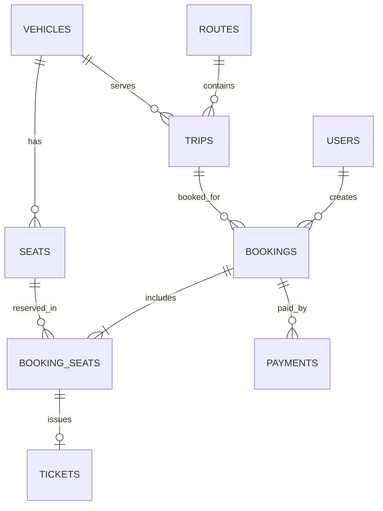

# ERD PostgreSQL

V10 thêm bảng cấu hình độc lập `site_settings` (một dòng): tiêu đề/HTML hướng dẫn, logo PNG, revision và thời điểm cập nhật. Chín bảng nghiệp vụ dưới đây giữ nguyên. Xem [quản lý nội dung và logo](site-content.md).

V7–V9 giữ nguyên chín bảng và quan hệ. `vehicles.seat_layout` hiện phân biệt CUSTOM/BUS_SLEEPER_34/TRAIN_11; `seats` có `coach_number`, `compartment_number`, `deck_number`, `position_number`, cùng CHECK và unique index cho vị trí. V8 mở rộng xe cũ lên 34 chỗ; V9 sửa thành giường nằm hai tầng ×17, giữ nguyên ID và mã chỗ đã có. Ghế legacy giữ tọa độ null để bảo toàn lịch sử. Chi tiết tại [seat-layouts.md](seat-layouts.md).

Booking có ít nhất một ghế là invariant nghiệp vụ, chưa được SQL tự bảo đảm.

Khóa ngoại kép:

- `bookings(trip_id,vehicle_id)` → `trips(id,vehicle_id)`.
- `booking_seats(booking_id,trip_id,vehicle_id)` → `bookings(id,trip_id,vehicle_id)`.
- `booking_seats(seat_id,vehicle_id)` → `seats(id,vehicle_id)`.

Chống chiếm trùng: unique `(trip_id,seat_id)` chỉ với `is_active IS TRUE`.

`payments.txn_ref`, `payments.provider_transaction_id`, `tickets.ticket_code`, `tickets.booking_seat_id` có uniqueness theo SQL. Vé chỉ được phát hành từ booking PAID ở service P6.

V6 bổ sung `payments.expires_at`, mã response/status và cờ/lý do đối soát; unique partial index chỉ cho một payment PENDING trên mỗi booking. Vẫn giữ chín bảng. Financial SUCCESS cần đối soát không tự chuyển booking thành PAID hoặc phát vé. Chi tiết tại [payment-api.md](payment-api.md).
